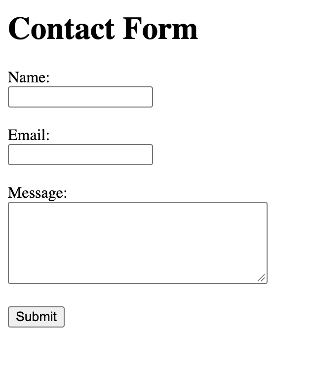
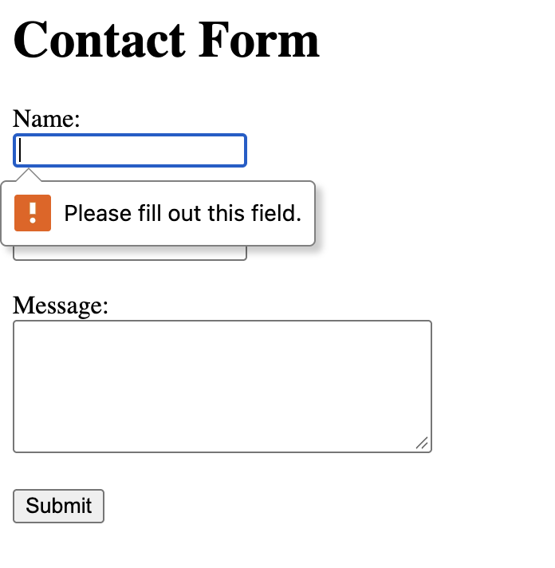
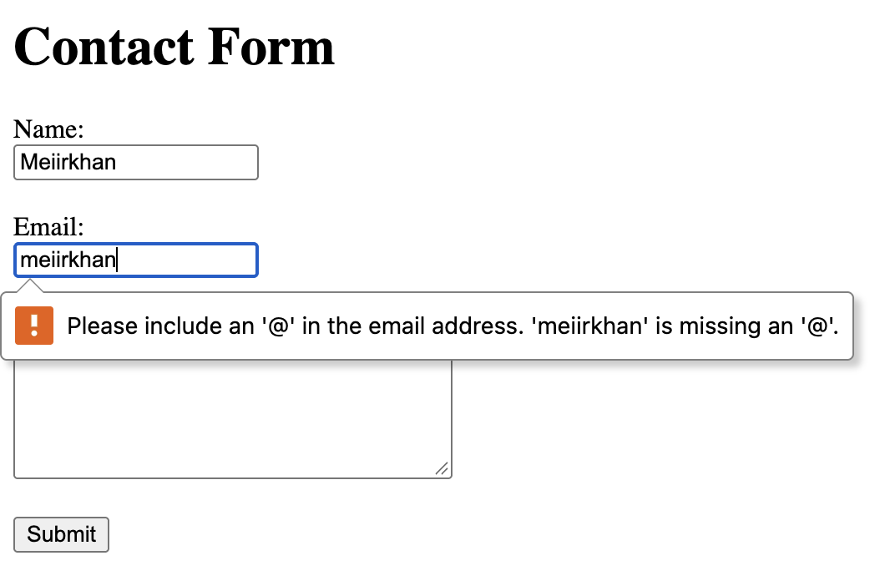
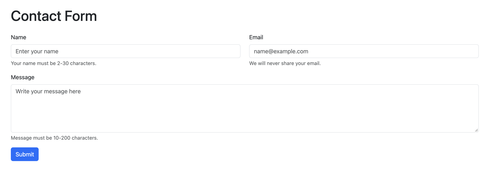
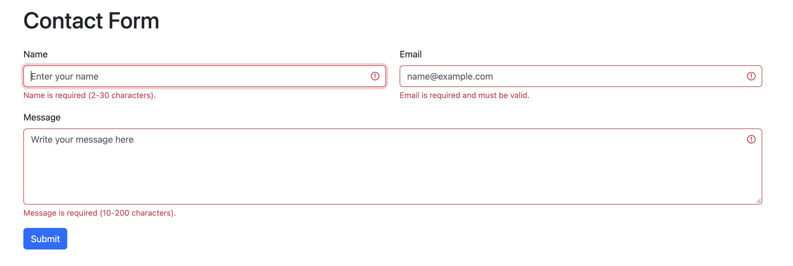
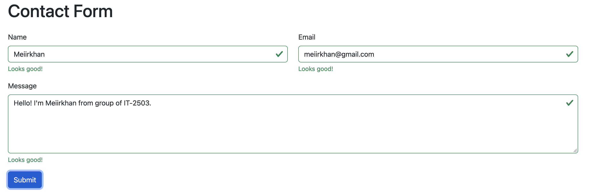
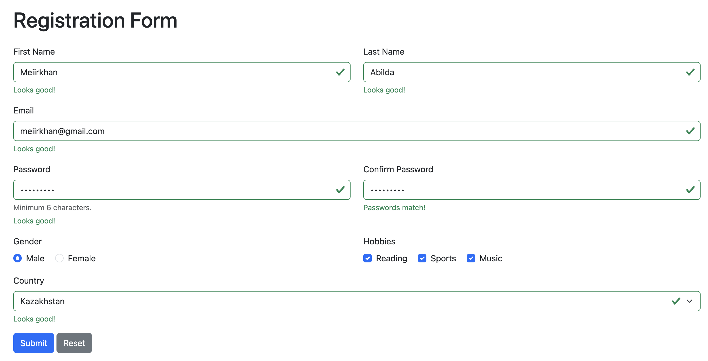
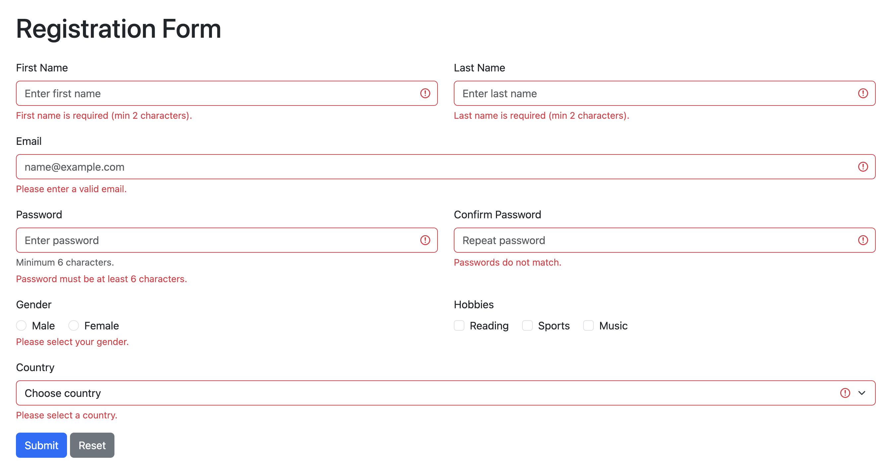

# Assignment 4. Forms and Validation

**Name:** Meiirkhan Abilda
**Group:** IT-2503

## Part 1. Basic HTML Forms

### Task 0. Simple Contact Form

Create a basic contact form with Name (text input), Email (email input), Message (textarea) and a Submit button. All fields must have proper `<label>` elements.

File: `task0.html`

### Task 1. Form with HTML5 Validation

Add built-in validation attributes (`required`, `type`, `maxlength`, etc.). Test how the browser enforces validation (e.g., email format, empty fields).

File: `task1.html`

## Part 2. Bootstrap Forms

### Task 2. Bootstrap Form Styling

Recreate the contact form using Bootstrap form classes. Use Bootstrap's grid system to arrange form fields. Add placeholders and helper text.

File: `task2.html`

### Task 3. Bootstrap Validation Styles

Apply Bootstrap's validation feedback classes (`is-valid`, `is-invalid`). Show feedback messages below inputs (e.g., "Email is required", "Looks good!"). Test the form with valid and invalid data.

File: `task3.html`

## Part 3. Advanced Form Project

### Task 4. Registration Form

Create a registration form with First Name, Last Name, Email, Password + Confirm Password, Gender (radio buttons), Hobbies (checkboxes), Country (select dropdown), Submit and Reset buttons. Style it with Bootstrap Grid so it is responsive. Add HTML5 validation (e.g., minimum password length) and Bootstrap validation feedback to display error/success messages.

File: `task4.html`

## Summary

First, I created a simple HTML contact form with labels and inputs (Task 0). Then I added HTML5 validation attributes such as `required`, `minlength`, `maxlength` and `type="email"` and tested them in the browser (Task 1). After that I recreated the form with Bootstrap classes (`form-control`, `form-label`, `form-text`) and arranged the fields with the Bootstrap grid (`row`, `col-md-6`) (Task 2). In Task 3 I used JavaScript with `checkValidity()` to add the Bootstrap classes `is-valid` and `is-invalid` and show feedback messages. Finally, in Task 4 I built a responsive registration form with all required fields, password length and password match validation, and Bootstrap validation feedback.
